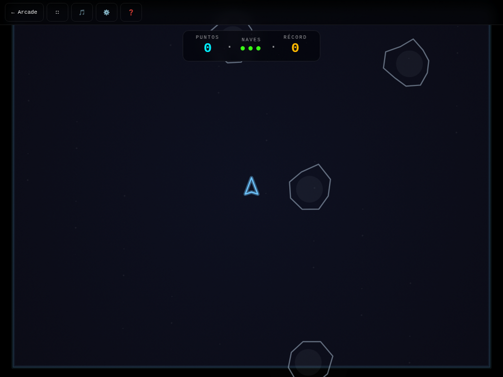

# 🚀 Asteroids

**Versión:** 1.7.0 | **Género:** Space Shooter | **Última actualización:** 2026-08-26

Navegá por el espacio destruyendo asteroides. Los grandes se parten en medianos, los medianos en chicos. ¡A sobrevivir!

## Captura

## Controles

| Dispositivo | Acción                                | Tecla / Control         |
| ----------- | ------------------------------------- | ----------------------- |
| ⌨️ Teclado  | Rotar izquierda                       | `←` / `A`               |
| ⌨️ Teclado  | Rotar derecha                         | `→` / `D`               |
| ⌨️ Teclado  | Acelerar                              | `↑` / `W`               |
| ⌨️ Teclado  | Disparar                              | `Espacio`               |
| ⌨️ Teclado  | Hiperspacio (teletransporte)          | `H`                     |
| ⌨️ Teclado  | Empezar / Reiniciar                   | `R`                     |
| 🎮 Gamepad  | Rotar / Acelerar                      | Stick / D-pad + botones |
| 👆 Táctil   | Botones en pantalla (d-pad + disparo) |                         |

## Características

- 💥 Asteroides que se fragmentan en 2 al destruirse (grande → mediano → chico)
- 🚀 Nave con inercia y wrapping en los bordes
- ⚡ Hiperspacio: teletransporte a una posición aleatoria para escapar
- 🛡️ Invulnerabilidad temporal al perder una vida
- 💥 Game feel: screen shake, hit-stop, squash & stretch, partículas neon en explosiones
- 🏆 Récord persistido en `localStorage`
- ♿ Accesibilidad: anuncios `aria-live`, prefers-reduced-motion
- 🎮 Soporte para teclado, táctil y gamepad

## Logros

- 🏆 **Pionero espacial** — Alcanzá 1.000 puntos de récord
- 🏆 **Hiperspacio** — Usá el hiperspacio una vez
- 🏆 **Superviviente** — Completá una oleada sin morir

## Detalles técnicos

- Canvas 2D sin dependencias externas
- Game loop con `shared/loop.js` (`createGameLoop` con RAF + dt + cleanup)
- Canvas responsive con `shared/display.js` (`setupCanvas` con DPR + letterboxing + resize debounce)
- HTML compartido inyectado vía `shared/dom.js` (`injectCommonElements`)
- Shell compartido y game-bar vía `shared/shell.js`
- Estilos neon desde `shared/base.css` (overlay, HUD, touch controls, game bar, noise CRT)
- Audio sintetizado con `shared/audio.js` (Web Audio API: beep, ambient drone)
- Récords persistentes vía `shared/scores.js`
- Game feel: screen shake por trauma, hit-stop, squash & stretch, partículas con object pool (500), `feedbackBundle` por tiers
- Rendimiento: glow sin `shadowBlur` (`drawGlow`), anti-tunneling en sub-pasos (proyectiles), object pooling
- Accesibilidad: `aria-live` announcements, `trapTab()` focus trapping, prefers-reduced-motion → `setShakeScale(0)`, modal de ayuda accesible (role=dialog + focus trap), canvas con `role="img"`, zoom móvil habilitado, `:focus-visible` global
- Persistencia en `localStorage` con key namespaced
- 3 modos de entrada: teclado (flechas/WASD + Espacio + H + R), táctil (botones responsive), gamepad (polling en loop)

## Changelog

- **1.7.0** (2026-08-27): Hiperspacio + stopMusic/stopAmbient + ambient drone único + achievements
- **1.6.0** (2026-08-26): Refactor: shell compartido `shared/shell.js` — game-bar, trampa de Tab y cleanup unificados | Refactor: récords vía `shared/scores.js` | Fix: teardown de audio garantizado y trampa de Tab liberada al terminar partida
- **1.5.1** (2026-08-26): Música lofi procedural vía `shared/music.js` + toggle 🎵 en game-bar (preferencia global persistida)
- **1.5.0** (2026-07-30): Game feel completo — `feedbackBundle()` integrado + squash & stretch + hit-stop; P0: `shadowBlur` eliminado de loops con `drawGlow()`; lint 0 errores/0 warnings
- **1.4.0** (2026-07-30): Migración a `shared/loop.js`; `shimmerFlow` a `base.css`; `drawGlow()` y `feedbackBundle()`
- **1.3.0** (2026-07-30): Canvas ID unificado + `setupCanvas()` vía `shared/display.js`; HTML compartido vía `shared/dom.js`
- **1.2.0** (2026-07-28): Refactor CSS a estética neon compartida en `base.css`; README con controles y descripción
- **1.1.0** (2026-07-28): Refactor a carpeta individual; botón ayuda + volver al hub; sub-pasos anti-tunneling; screen shake y partículas
- **1.0.0** (2026-06-10): Versión inicial del juego
