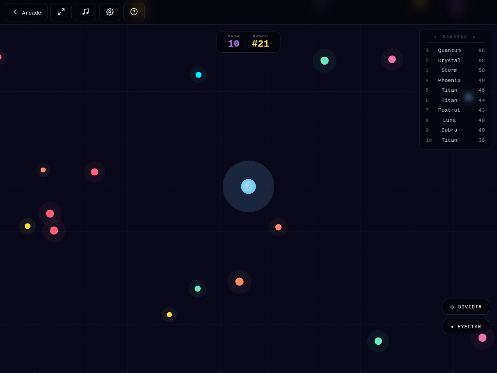

# 🟣 Cell Swarm

**Versión:** 1.7.0 | **Género:** Battle Royale | **Última actualización:** 2026-08-26

Battle royale de células neón. Crece comiendo comida y células más pequeñas, divide tu masa para cazar, eyecta para distraer. ¡Conviértete en la célula más grande del mapa!

## Captura

## Controles

| Dispositivo | Acción                    | Tecla / Control        |
| ----------- | ------------------------- | ---------------------- |
| 🖱️ Mouse    | Moverse                   | Mover el cursor        |
| ⌨️ Teclado  | Dividir (Split)           | `Espacio`              |
| ⌨️ Teclado  | Eyectar masa              | `E`                    |
| ⌨️ Teclado  | Boost (impulso)           | `Shift` (consume masa) |
| 🎮 Gamepad  | Moverse                   | Stick izquierdo        |
| 🎮 Gamepad  | Dividir                   | Botón A                |
| 🎮 Gamepad  | Eyectar                   | Botón B                |
| 👆 Táctil   | Moverse                   | Deslizar el dedo       |
| 👆 Táctil   | Dividir / Eyectar / Boost | Botones en pantalla    |

## Características

- 🌍 Mapa amplio de 5000×5000 con cámara dinámica
- 🤖 20 bots con IA avanzada (5 personalidades: agresivo, tímido, equilibrado, cazador, cobarde)
- 🧬 Esquiva de proyectiles (bots huyen de splits enemigos)
- ✂️ Split: divide tu célula en 2 para atrapar presas rápidas
- 💨 Eyectar: dispara masa para distraer o alimentar
- ⚡ Boost: impulso ×1.8 de velocidad consumiendo masa (`Shift`)
- 🔻 Mass decay: tu masa se reduce con el tiempo para evitar camping
- ☣️ Viruses: obstáculos verdes que dividen las células de más de 120 de masa
- 🧱 Border kill: tocar el borde del mundo es muerte instantánea
- 🟡 Chaser pellets: orugas amarillas que huyen y dan bonus ×3 con boost
- 🏆 Ranking en tiempo real de las 10 células más grandes
- 🎨 Skins especiales: banderas de países, emojis, degradados
- 💥 Game feel: screen shake, hit-stop, partículas neon al dividir y absorber
- 🏆 Récord de masa persistido en `localStorage`
- 🎖️ 6 logros desbloqueables (primera presa, cazador, splitter, masa récord, titán, alfa)
- ♿ Accesibilidad: anuncios `aria-live`, prefers-reduced-motion
- 🎮 Soporte para mouse, teclado, táctil y gamepad

## Logros

- 🏆 **Primera presa** — Devorá tu primer bot
- 🔪 **Cazador** — Devorá 5 bots en una partida
- ✂️ **Splitter** — Eliminá un bot con un proyectil de división
- 💪 **Grande** — Alcanzá 200 de masa récord
- 🦖 **Titán** — Alcanzá 500 de masa récord
- 👑 **Alfa** — Convertite en la célula más grande del mapa

## Detalles técnicos

- Canvas 2D sin dependencias externas
- Game loop con `shared/loop.js` (`createGameLoop` con RAF + dt + cleanup)
- Canvas responsive con `shared/display.js` (`setupCanvas` con DPR + letterboxing + resize debounce)
- HTML compartido inyectado vía `shared/dom.js` (`injectCommonElements`)
- Shell compartido y game-bar vía `shared/shell.js`
- Estilos neon desde `shared/base.css` (overlay, HUD, touch controls, game bar, noise CRT)
- Audio sintetizado con `shared/audio.js` (Web Audio API: beep, ambient drone)
- Récords persistentes vía `shared/scores.js`
- Game feel: screen shake por trauma, hit-stop, squash & stretch, partículas con object pool (500), `feedbackBundle` por tiers
- Rendimiento: glow sin `shadowBlur` (`drawGlow`), object pooling
- Accesibilidad: `aria-live` announcements, `trapTab()` focus trapping, prefers-reduced-motion → `setShakeScale(0)`, modal de ayuda accesible (role=dialog + focus trap), canvas con `role="img"`, zoom móvil habilitado, `:focus-visible` global
- Persistencia en `localStorage` con key namespaced
- 4 modos de entrada: mouse, teclado (Espacio + E + Shift), táctil (deslizar + botones), gamepad (polling en loop)

## Changelog

- **1.7.0** (2026-08-27): stopMusic/stopAmbient + ambient drone único
- **1.6.0** (2026-08-26): Fidelidad Agar.io/Slither.io — mass decay con el tiempo (previene camping), boost (`Shift`, ×1.8 consumiendo masa), viruses que dividen células > 120 masa, border kill (tocar el borde = muerte), chaser pellets que huyen y dan bonus ×3 con boost, y botón de boost táctil (⚡)
- **1.5.0** (2026-08-26): Refactor: shell compartido `shared/shell.js` — game-bar, trampa de Tab y cleanup unificados | Refactor: récords vía `shared/scores.js` | Fix: teardown de audio garantizado y trampa de Tab liberada al terminar partida
- **1.4.2** (2026-08-26): Música lofi procedural vía `shared/music.js` + toggle 🎵 en game-bar (preferencia global persistida)
- **1.4.1** (2026-08-12): Sistema de logros completo — 6 logros con `achievements.unlock()` (primera presa, cazador, splitter, masa récord, titán, alfa)
- **1.4.0** (2026-07-30): Game feel completo — `feedbackBundle()` integrado + squash & stretch + hit-stop; P0: `shadowBlur` eliminado de loops con `drawGlow()`; lint 0 errores/0 warnings
- **1.3.0** (2026-07-30): Migración a `shared/loop.js`; `shimmerFlow` a `base.css`; `drawGlow()` y `feedbackBundle()`
- **1.2.0** (2026-07-30): Canvas ID unificado + `setupCanvas()` vía `shared/display.js`; HTML compartido vía `shared/dom.js`
- **1.1.0** (2026-07-28): Refactor CSS a estética neon compartida en `base.css`; README con controles y descripción; IA de bots con personalidades; esquiva de proyectiles; skins especiales por nombre; fix botón de ayuda
- **1.0.0** (2026-07-28): Versión inicial del juego