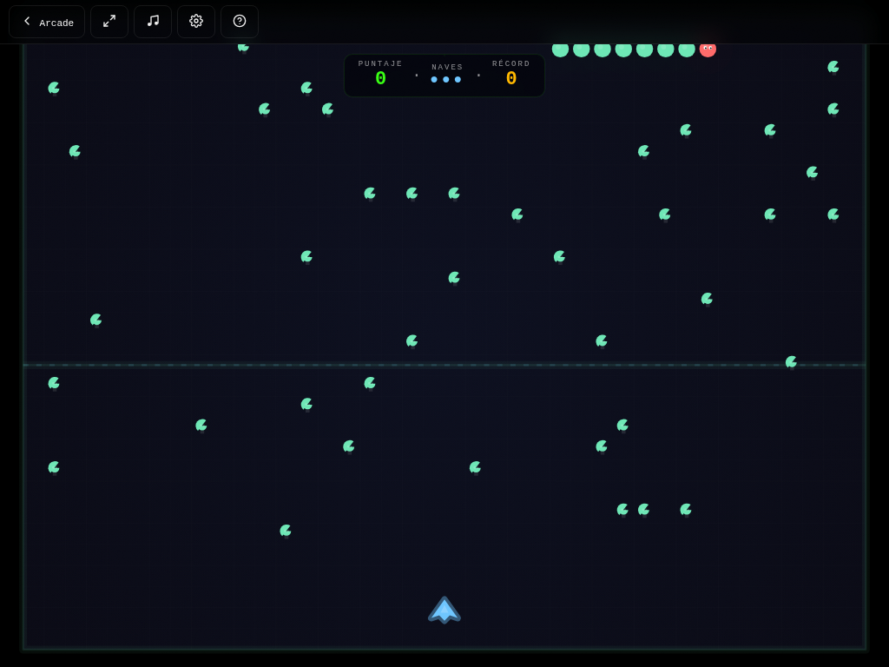

# 🐛 Centipede

**Versión:** 1.6.0 | **Género:** Arcade | **Última actualización:** 2026-08-26

Dispará al ciempiés mientras serpentea entre hongos. Cada segmento que destruyas se convierte en un hongo nuevo. ¡Cuidado con la araña saltarina, las pulgas y los escorpiones!

## Captura

## Controles

| Dispositivo | Acción              | Tecla / Control       |
| ----------- | ------------------- | --------------------- |
| ⌨️ Teclado  | Mover               | `← → ↑ ↓` / `W A S D` |
| ⌨️ Teclado  | Disparar            | `Espacio`             |
| ⌨️ Teclado  | Empezar / Reiniciar | `R`                   |
| 🎮 Gamepad  | Movimiento          | Stick izquierdo       |
| 🎮 Gamepad  | Disparar            | Botón A               |
| 👆 Táctil   | Botones en pantalla |                       |

## Características

- 🐛 Ciempiés que serpentea y se divide al ser disparado: cada segmento destruido separa la cola en un ciempiés nuevo e independiente
- 📐 Fidelidad arcade: el jugador está restringido al tercio inferior de la pantalla
- 🍄 Hongos que crecen con cada impacto
- 🕷️ Araña saltarina que rebota en los bordes
- 🪰 Pulgas que caen del cielo dejando hongos
- 🦂 Escorpiones que envenenan hongos
- 💥 Game feel: screen shake, hit-stop, partículas neon en impactos
- 🏆 Récord persistido en `localStorage`
- ♿ Accesibilidad: anuncios `aria-live`, prefers-reduced-motion
- 🎮 Soporte para teclado, táctil y gamepad

## Logros

- 🏆 **Cazador de ciempiés** — Alcanzá 1.000 puntos de récord

## Detalles técnicos

- Canvas 2D sin dependencias externas
- Game loop con `shared/loop.js` (`createGameLoop` con RAF + dt + cleanup)
- Canvas responsive con `shared/display.js` (`setupCanvas` con DPR + letterboxing + resize debounce)
- HTML compartido inyectado vía `shared/dom.js` (`injectCommonElements`)
- Shell compartido y game-bar vía `shared/shell.js`
- Estilos neon desde `shared/base.css` (overlay, HUD, touch controls, game bar, noise CRT)
- Audio sintetizado con `shared/audio.js` (Web Audio API: beep, ambient drone)
- Récords persistentes vía `shared/scores.js`
- Game feel: screen shake por trauma, hit-stop, squash & stretch, partículas con object pool (500), `feedbackBundle` por tiers
- Rendimiento: glow sin `shadowBlur` (`drawGlow`), anti-tunneling en sub-pasos, object pooling
- Accesibilidad: `aria-live` announcements, `trapTab()` focus trapping, prefers-reduced-motion → `setShakeScale(0)`, modal de ayuda accesible (role=dialog + focus trap), canvas con `role="img"`, zoom móvil habilitado, `:focus-visible` global
- Persistencia en `localStorage` con key namespaced
- 3 modos de entrada: teclado (flechas/WASD + Espacio + R), táctil (botones responsive), gamepad (polling en loop)

## Changelog

- **1.6.0** (2026-08-26): Fidelidad arcade — el jugador se mueve solo por el tercio inferior de la pantalla y splitting clásico (al destruir un segmento, la cola se convierte en un ciempiés independiente) | Refactor: shell compartido `shared/shell.js` — game-bar, trampa de Tab y cleanup unificados | Refactor: récords vía `shared/scores.js` | Fix: teardown de audio garantizado y trampa de Tab liberada al terminar partida
- **1.5.1** (2026-08-26): Música lofi procedural vía `shared/music.js` + toggle 🎵 en game-bar (preferencia global persistida)
- **1.5.0** (2026-07-30): Game feel completo — `feedbackBundle()` integrado + squash & stretch + hit-stop; P0: `shadowBlur` eliminado de loops con `drawGlow()`; lint 0 errores/0 warnings; R3: constantes extraídas (velocidades, intervalos de olas); fix refs rotas mouseX/Y→player.x/y
- **1.4.0** (2026-07-30): Migración a `shared/loop.js`; `shimmerFlow` a `base.css`; `drawGlow()` y `feedbackBundle()`
- **1.3.0** (2026-07-30): Canvas ID unificado + `setupCanvas()` vía `shared/display.js`; HUD IDs legibles; HTML compartido vía `shared/dom.js`
- **1.2.0** (2026-07-28): Refactor CSS a estética neon compartida en `base.css`; README con controles y descripción
- **1.1.0** (2026-07-28): Refactor a carpeta individual; botón ayuda + volver al hub; nuevos enemigos: pulgas y escorpiones; screen shake y partículas
- **1.0.0** (2026-07-20): Versión inicial del juego
