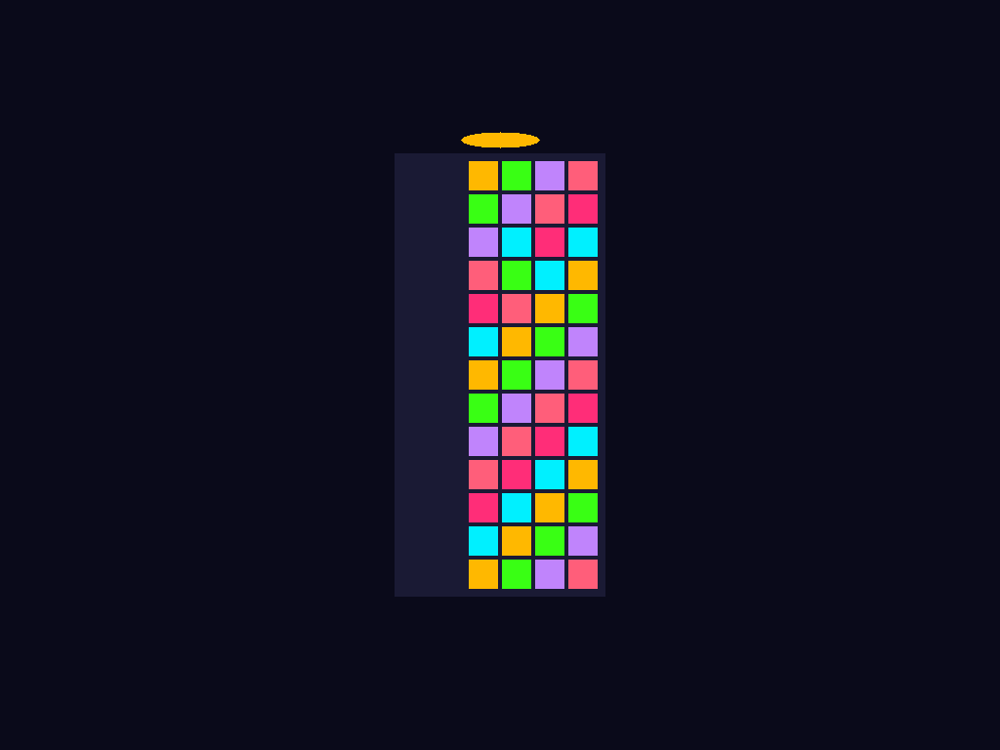

# 💎 Columns

**Versión:** 1.1.0 | **Género:** Puzzle | **Última actualización:** 2026-08-28

Puzzle de gemas clásico. Armá combinaciones de 3+ gemas del mismo color en cualquier dirección para eliminarlas. El juego termina cuando las gemas llegan arriba del tablero.

## Captura

## Controles

| Dispositivo | Acción                      | Tecla / Control      |
| ----------- | --------------------------- | -------------------- |
| ⌨️ Teclado  | Mover izquierda             | `←` / `A`            |
| ⌨️ Teclado  | Mover derecha               | `→` / `D`            |
| ⌨️ Teclado  | Rotar pieza                 | `↑` / `W`            |
| ⌨️ Teclado  | Caída suave                 | `↓` / `S` (mantener) |
| ⌨️ Teclado  | Hard drop                   | `Espacio`            |
| ⌨️ Teclado  | Pausar                      | `Espacio` / `P`      |
| ⌨️ Teclado  | Reiniciar                   | `R`                  |
| 🎮 Gamepad  | Mover                       | D-pad / Stick        |
| 🎮 Gamepad  | Rotar                       | D-pad arriba         |
| 🎮 Gamepad  | Hard drop                   | Botón A              |
| 🎮 Gamepad  | Empezar / Pausar            | Start                |
| 👆 Táctil   | D-pad + botones en pantalla |                      |

## Características

- 💎 Grid 6×13 con gemas de 6 colores
- 🔍 Match detection en 4 direcciones (horizontal, vertical, diagonal ↘, diagonal ↙)
- 👻 Ghost piece que muestra dónde caerá la pieza
- ✨ Power-ups: **flash** (transforma gemas adyacentes), **rayo** (limpia una fila), **veneno** (recolorea al azar)
- ⚡ Nivel progresivo: velocidad aumenta cada 25 gemas limpiadas
- 💥 Game feel: screen shake, partículas neon al hacer match
- 📊 Puntaje y récord persistido en `localStorage`
- ♿ Accesibilidad: anuncios `aria-live`, prefers-reduced-motion
- 🎮 Soporte para teclado, táctil y gamepad

## Logros

- 🏆 **Maestro de cadenas** — Hacé 3+ clears en cadena en un solo movimiento
- 🏆 **Coleccionista de colores** — Tené los 6 colores en el tablero al mismo tiempo
- 🏆 **Maratón** — Sobreviví 50 niveles

## Detalles técnicos

- Canvas 2D sin dependencias externas
- Game loop con `shared/loop.js` (`createGameLoop` con RAF + dt + cleanup)
- Canvas responsive con `shared/display.js` (`setupCanvas` con DPR + letterboxing)
- Shell compartido vía `shared/shell.js`
- Audio sintetizado con `shared/audio.js` (Web Audio API)
- Game feel: screen shake, partículas con object pool, `feedbackBundle`
- Persistencia en `localStorage` con key namespaced (`columns2d`)
- 3 modos de entrada: teclado, táctil, gamepad

## Changelog

- **1.0.0** (2026-08-28): Initial release
- **1.1.0** (2026-08-28): Logros alineados a la spec, power-ups flash/rayo/veneno, nivel cada 25 gemas
