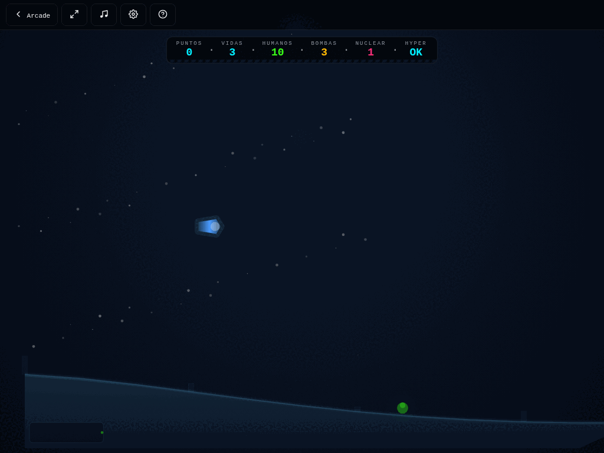

# 🚀 Defender

**Versión:** 1.5.0 | **Género:** Shooter | **Última actualización:** 2026-08-26

Side-scrolling shooter clásico. Defendé a los humanos de la invasión alienígena en un mundo que se desplaza horizontalmente.

## Captura

## Controles

| Dispositivo | Acción                                                 | Tecla / Control         |
| ----------- | ------------------------------------------------------ | ----------------------- |
| ⌨️ Teclado  | Movimiento                                             | `↑ ↓ ← →` / `W A S D`   |
| ⌨️ Teclado  | Disparar                                               | `Espacio`               |
| ⌨️ Teclado  | Bomba inteligente                                      | `B`                     |
| ⌨️ Teclado  | Hiperspacio (teleport, 5s cooldown)                    | `H`                     |
| ⌨️ Teclado  | Bomba nuclear (1 por vida)                             | `N`                     |
| ⌨️ Teclado  | Empezar / Reiniciar                                    | `Espacio` / `R`         |
| 🎮 Gamepad  | Movimiento                                             | Stick izquierdo / D-pad |
| 🎮 Gamepad  | Disparar                                               | Botón A                 |
| 🎮 Gamepad  | Bomba inteligente                                      | Botón B                 |
| 🎮 Gamepad  | Hiperspacio                                            | Botón X                 |
| 🎮 Gamepad  | Bomba nuclear                                          | Botón Y                 |
| 👆 Táctil   | D-pad + botones (disparo, bomba, hiperspacio, nuclear) |                         |

## Características

- 🏔️ Terreno procedural con montañas que se desplazan
- 👽 3 tipos de enemigos: Landers (secuestran humanos), Bombers (lanzan bombas), Mutantes (persecución)
- 👨‍👩‍👧‍👧 10 humanos para defender repartidos por el mundo
- 💣 Bombas inteligentes que limpian la pantalla
- ⚡ Hiperspacio (`H`): teletransporte con cooldown de 5s para escapar de aprietos
- ☢️ Bomba nuclear (`N`): 1 por vida, destruye todo en pantalla
- 📡 Mini-radar en pantalla para localizar enemigos y humanos
- 🪂 Humanos rescatados caen en paracaídas
- 🔫 Sistema de puntuación progresivo con niveles
- 💥 Game feel: screen shake, hit-stop, squash & stretch, partículas neon en explosiones
- 🏆 Récord persistido en `localStorage`
- ♿ Accesibilidad: anuncios `aria-live`, prefers-reduced-motion
- 🎮 Soporte para teclado, táctil y gamepad

## Logros

- 🏆 **Primera baja** — Eliminá tu primer enemigo
- 🏆 **Tres bombas** — Usá 3 bombas inteligentes
- 🏆 **Comandante** — Alcanzá 10.000 puntos en una partida

## Detalles técnicos

- Canvas 2D sin dependencias externas
- Game loop con `shared/loop.js` (`createGameLoop` con RAF + dt + cleanup)
- Canvas responsive con `shared/display.js` (`setupCanvas` con DPR + letterboxing + resize debounce)
- HTML compartido inyectado vía `shared/dom.js` (`injectCommonElements`)
- Shell compartido y game-bar vía `shared/shell.js`
- Estilos neon desde `shared/base.css` (overlay, HUD, touch controls, game bar, noise CRT)
- Audio sintetizado con `shared/audio.js` (Web Audio API: beep, ambient drone)
- Récords persistentes vía `shared/scores.js`
- Game feel: screen shake por trauma, hit-stop, squash & stretch, partículas con object pool (500), `feedbackBundle` por tiers
- Rendimiento: glow sin `shadowBlur` (`drawGlow`), anti-tunneling en sub-pasos, object pooling
- Mundo de 6000px de ancho con scroll horizontal y cámara con suavizado
- Accesibilidad: `aria-live` announcements, `trapTab()` focus trapping, prefers-reduced-motion → `setShakeScale(0)`, modal de ayuda accesible (role=dialog + focus trap), canvas con `role="img"`, zoom móvil habilitado, `:focus-visible` global
- Persistencia en `localStorage` con key namespaced
- 3 modos de entrada: teclado (flechas/WASD + Espacio + B + H + N + R), táctil (botones responsive), gamepad (polling en loop)

## Changelog

- **1.5.0** (2026-08-26): Auditoría — agregados hiperspacio (teleport, 5s cooldown, tecla `H`) y bomba nuclear (1 por vida, tecla `N`) — las 4 armas del original
- **1.4.0** (2026-08-26): Refactor: shell compartido `shared/shell.js` — game-bar, trampa de Tab y cleanup unificados | Refactor: récords vía `shared/scores.js` | Fix: ahora libera la trampa de Tab al terminar partida (antes quedaba activa) y el botón hub funciona dentro del iframe del hub
- **1.3.1** (2026-08-26): Música lofi procedural vía `shared/music.js` + toggle 🎵 en game-bar (preferencia global persistida)
- **1.3.0** (2026-07-30): Game feel completo — `feedbackBundle()` integrado + squash & stretch + hit-stop; P0: `shadowBlur` eliminado de loops con `drawGlow()`; lint 0 errores/0 warnings; R3: constantes extraídas (márgenes, límites de oleadas); fix refs rotas ship→player
- **1.2.0** (2026-07-30): Migración a `shared/loop.js`; `shimmerFlow` a `base.css`; `drawGlow()` y `feedbackBundle()`
- **1.1.0** (2026-07-30): Canvas ID unificado + `setupCanvas()` vía `shared/display.js`; HTML compartido vía `shared/dom.js`
- **1.0.0** (2026-07-28): Versión inicial del juego — side-scrolling procedural, landers/bombers/mutantes, smart bombs, radar, niveles progresivos, 3 modos de entrada
