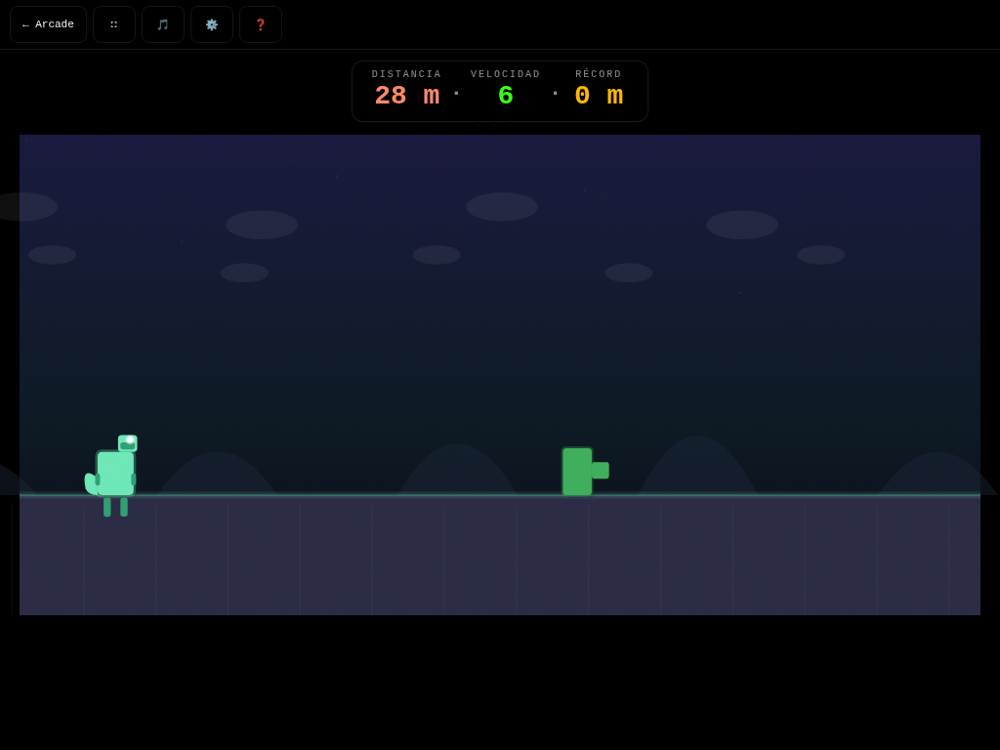

# 🦖 Dino Runner

**Versión:** 1.8.0 | **Género:** Plataformas | **Última actualización:** 2026-08-26

Corré, saltá y agachate para esquivar cactus y pterodáctilos. La velocidad aumenta con el tiempo. ¿Cuánto podés durar?

## Captura

## Controles

| Dispositivo | Acción                                 | Tecla / Control       |
| ----------- | -------------------------------------- | --------------------- |
| ⌨️ Teclado  | Saltar                                 | `Espacio` / `↑`       |
| ⌨️ Teclado  | Agacharse                              | `↓`                   |
| ⌨️ Teclado  | Fast-fall (↓ en el aire)               | `↓`                   |
| ⌨️ Teclado  | Empezar                                | `Espacio` / `R`       |
| 🎮 Gamepad  | Saltar                                 | Botón A / X           |
| 🎮 Gamepad  | Agacharse                              | Botón B / stick abajo |
| 👆 Táctil   | Botones Saltar y Agacharse en pantalla |                       |

## Características

- 🏃‍♂️ Velocidad progresiva con el tiempo
- 🌵 Cactus de distintos tamaños y clusters
- 🦅 Pterodáctilos con 3 alturas fijas (high/mid/low) a partir de cierta distancia
- ⚡ Fast-fall: presioná ↓ en el aire para acelerar la caída
- 🌙 Ciclo día/noche automático cada 100 m
- 👁️ Parpadeo del dino cada 3.5 s
- ☁️ Nubes parallax multi-capa
- 🎂 Easter egg: pastel en la cabeza del dino
- 🔔 Chime de hito cada 1000 m
- 💥 Game feel: screen shake, hit-stop, partículas neon al chocar y al saltar
- 🏆 Récord persistido en `localStorage`
- ♿ Accesibilidad: anuncios `aria-live`, prefers-reduced-motion
- 🌓 Soporte de tema claro/oscuro
- 🎮 Soporte para teclado, táctil y gamepad

## Logros

- 🏆 **Velocista** — Alcanzá 500 puntos de récord
- 🏆 **Maratón** — Corré 1000m
- 🏆 **Búho nocturno** — Sobreviví la noche

## Consejos

- Agacharse solo funciona en el suelo (no en el aire)
- La velocidad máxima se alcanza gradualmente
- En el aire, ↓ acelera la caída para esquivar mejor a los pterodáctilos

## Detalles técnicos

- Canvas 2D sin dependencias externas
- Game loop con `shared/loop.js` (`createGameLoop` con RAF + dt + cleanup)
- Canvas responsive con `shared/display.js` (`setupCanvas` con DPR + letterboxing + resize debounce)
- HTML compartido inyectado vía `shared/dom.js` (`injectCommonElements`)
- Estilos neon desde `shared/base.css` (overlay, HUD, touch controls, game bar, noise CRT)
- Audio sintetizado con `shared/audio.js` (Web Audio API: beep)
- Game feel: screen shake por trauma, hit-stop, squash & stretch, partículas con object pool (500), `feedbackBundle` por tiers
- Rendimiento: glow sin `shadowBlur` (`drawGlow`), anti-tunneling en sub-pasos, object pooling
- Accesibilidad: `aria-live` announcements, `trapTab()` focus trapping, prefers-reduced-motion → `setShakeScale(0)`, modal de ayuda accesible (role=dialog + focus trap), canvas con `role="img"`, zoom móvil habilitado, `:focus-visible` global
- Persistencia en `localStorage` con key namespaced
- 3 modos de entrada: teclado (Espacio/↑/↓ + R), táctil (botones responsive), gamepad (polling en loop)

## Changelog

- **1.8.0** (2026-08-27): Fix gravedad + stopMusic/stopAmbient + ambient drone único + achievements
- **1.7.0** (2026-08-26): Paridad Chrome Dino — fast-fall (↓ en el aire acelera la caída), day/night cycling automático cada 100m, pterodáctilos con 3 alturas fijas (high/mid/low), parpadeo del dino cada 3.5s, nubes parallax multi-capa, easter egg (pastel en la cabeza del dino) y milestone chime cada 1000m
- **1.6.0** (2026-08-26): Refactor — shell compartido `shared/shell.js` (game-bar, trampa de Tab y cleanup unificados) + récords vía `shared/scores.js`
- **1.5.2** (2026-08-26): Música lofi procedural vía `shared/music.js` + toggle 🎵 en game-bar (preferencia global persistida)
- **1.5.1** (2026-08-12): Squash & stretch real — stretch al saltar (`triggerSquash`) y squash al aterrizar, aplicado en `drawDino()` (cierra G5)
- **1.5.0** (2026-07-30): Game feel completo — `feedbackBundle()` integrado + squash & stretch + hit-stop; P0: `shadowBlur` eliminado de loops con `drawGlow()`; lint 0 errores/0 warnings; R3: hitbox del dino extraída a constantes; fix refs rotas
- **1.4.0** (2026-07-30): Migración a `shared/loop.js`; `shimmerFlow` a `base.css`; `drawGlow()` y `feedbackBundle()`; constantes extraídas
- **1.3.0** (2026-07-30): Canvas ID unificado + `setupCanvas()` vía `shared/display.js`; HTML compartido vía `shared/dom.js`
- **1.2.0** (2026-07-28): Refactor CSS a estética neon compartida en `base.css`; README con controles y descripción
- **1.1.0** (2026-07-28): Refactor a carpeta individual; botón ayuda + volver al hub; screen shake y partículas; sub-pasos de colisión anti-tunneling
- **1.0.0** (2026-06-08): Versión inicial del juego
