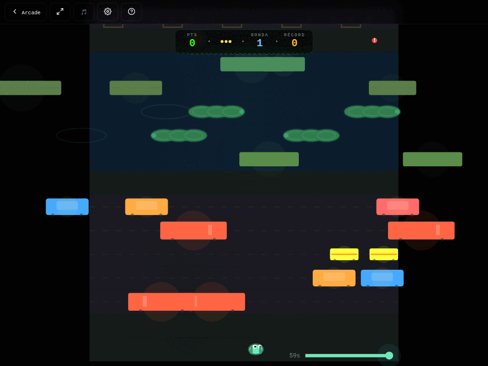

# 🐸 Frogger

**Versión:** 1.8.0 | **Género:** Arcade | **Última actualización:** 2026-08-26

Cruzá la calle y el río esquivando autos, camiones y cayendo al agua. Completá las 5 zonas seguras y avanzá a niveles infinitos.

## Captura

## Controles

| Dispositivo | Acción                        | Tecla / Control |
| ----------- | ----------------------------- | --------------- |
| ⌨️ Teclado  | Mover arriba                  | `↑` / `W`       |
| ⌨️ Teclado  | Mover abajo                   | `↓` / `S`       |
| ⌨️ Teclado  | Mover izquierda               | `←` / `A`       |
| ⌨️ Teclado  | Mover derecha                 | `→` / `D`       |
| ⌨️ Teclado  | Empezar / Reiniciar           | `Espacio` / `R` |
| 🎮 Gamepad  | Movimiento                    | D-pad / Stick   |
| 👆 Táctil   | D-pad direccional en pantalla |                 |

## Características

- 🚗 Múltiples carriles con vehículos: camiones lentos y largos, autos medianos y race cars angostos y rápidos
- 🪵 Troncos flotantes y tortugas para cruzar el río
- 🐢 Tortugas que se sumergen: en dos filas del río hay grupos de tortugas con ciclo de inmersión visible (parpadean antes de hundirse); si te hunden con ellas encima, perdés la vida
- 🐊 Cocodrilos en el río: abren y cierran la boca periódicamente y matan al tocarlos
- ⏱️ Timer global de 60s por nivel (no resetea por vida) con barra neon y aviso a los 10 segundos
- 🏆 5 zonas seguras para completar el nivel; al completarlos avanza a niveles infinitos
- 🎁 Bonus en los carriles seguros: mosca (200 pts), mariposa (100 pts) y serpiente (mata)
- ❤️ Vida extra al llegar a 10.000 y 20.000 puntos
- ⏳ Time bonus al llegar a un goal: 10 pts por segundo restante
- 💥 Game feel: screen shake, hit-stop, partículas neon al morir y al completar nivel
- 🏆 Récord persistido en `localStorage`
- ♿ Accesibilidad: anuncios `aria-live`, prefers-reduced-motion
- 🎮 Soporte para teclado, táctil y gamepad

## Logros

- 🏆 **Rana experta** — Alcanzá 1.000 puntos de récord
- 🏆 **Héroe** — Alcanzá 3 goals en una partida
- 🏆 **Coleccionista** — Comé un bonus item

## Detalles técnicos

- Canvas 2D sin dependencias externas
- Game loop con `shared/loop.js` (`createGameLoop` con RAF + dt + cleanup)
- Canvas responsive con `shared/display.js` (`setupCanvas` con DPR + letterboxing + resize debounce)
- HTML compartido inyectado vía `shared/dom.js` (`injectCommonElements`)
- Estilos neon desde `shared/base.css` (overlay, HUD, touch controls, game bar, noise CRT)
- Audio sintetizado con `shared/audio.js` (Web Audio API: beep)
- Game feel: screen shake por trauma, hit-stop, squash & stretch, partículas con object pool (500), `feedbackBundle` por tiers
- Rendimiento: glow sin `shadowBlur` (`drawGlow`), object pooling
- Accesibilidad: `aria-live` announcements, `trapTab()` focus trapping, prefers-reduced-motion → `setShakeScale(0)`, modal de ayuda accesible (role=dialog + focus trap), canvas con `role="img"`, zoom móvil habilitado, `:focus-visible` global
- Persistencia en `localStorage` con key namespaced
- 3 modos de entrada: teclado (flechas/WASD + Espacio + R), táctil (d-pad responsive), gamepad (polling en loop)

## Changelog

- **1.8.0** (2026-08-27): stopMusic/stopAmbient + ambient drone único + achievements
- **1.7.0** (2026-08-26): Paridad arcade — timer global por nivel (no resetea por vida), cocodrilos en el río (boca abre/cierra y matan al tocar), niveles infinitos (al completar 5 goals avanza al siguiente nivel), race cars angostos y rápidos, trucks lentos y largos, bonus items (fly 200 pts, butterfly 100 pts, snake mata), vida extra a 10.000 y 20.000 puntos y time bonus de 10 pts por segundo restante al llegar a un goal
- **1.6.0** (2026-08-26): Mecánicas arcade — timer de 60s por vida (barra + aviso) y tortugas sumergibles en filas 4 y 5 del río con ciclo visible y parpadeo previo
- **1.5.1** (2026-08-26): Música lofi procedural vía `shared/music.js` + toggle 🎵 en game-bar (preferencia global persistida)
- **1.5.0** (2026-07-30): Game feel completo — `feedbackBundle()` integrado + squash & stretch + hit-stop; P0: `shadowBlur` eliminado de loops con `drawGlow()`; lint 0 errores/0 warnings
- **1.4.0** (2026-07-30): Migración a `shared/loop.js`; `shimmerFlow` a `base.css`; `drawGlow()` y `feedbackBundle()`; R3: magic numbers extraídos a constantes nombradas
- **1.3.0** (2026-07-30): Canvas ID unificado + `setupCanvas()` vía `shared/display.js`; HUD IDs legibles; HTML compartido vía `shared/dom.js`
- **1.2.0** (2026-07-28): Refactor CSS a estética neon compartida en `base.css`; README con controles y descripción
- **1.1.0** (2026-07-28): Refactor a carpeta individual; botón ayuda + volver al hub; partículas refactorizadas a `shared/effects.js`
- **1.0.0** (2026-06-22): Versión inicial del juego
