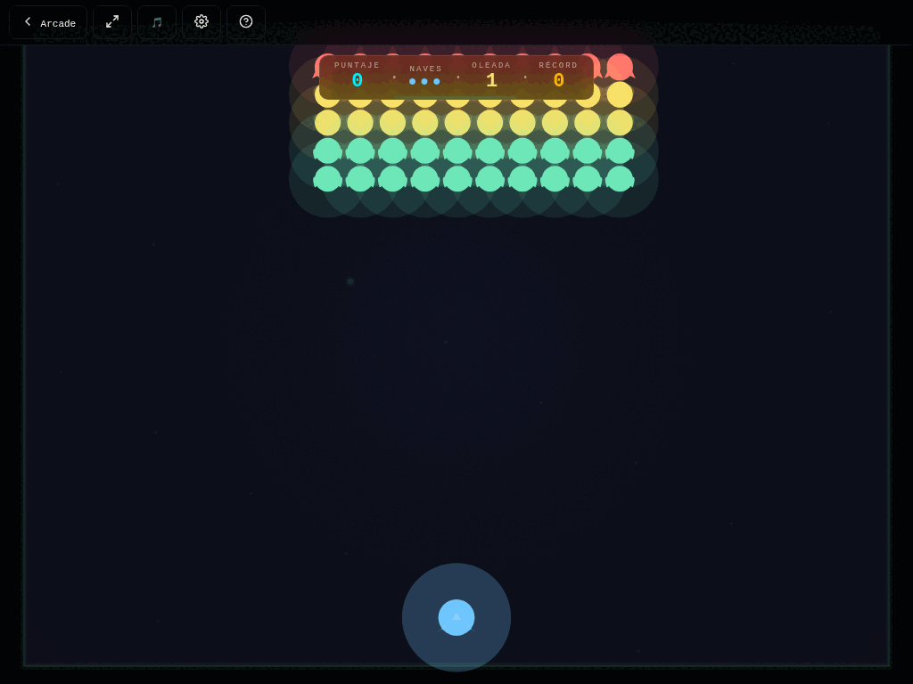

# 🛸 Galaga

**Versión:** 1.9.0 | **Género:** Space Shooter | **Última actualización:** 2026-08-26

Destruí oleadas de invasores en formación. Esquivá sus picados en espiral y sobreviví el mayor tiempo posible.

## Captura

## Controles

| Dispositivo | Acción                              | Tecla / Control |
| ----------- | ----------------------------------- | --------------- |
| ⌨️ Teclado  | Mover izquierda                     | `←` / `A`       |
| ⌨️ Teclado  | Mover derecha                       | `→` / `D`       |
| ⌨️ Teclado  | Disparar                            | `Espacio`       |
| ⌨️ Teclado  | Empezar / Reiniciar                 | `Espacio` / `R` |
| 🎮 Gamepad  | Movimiento                          | Stick / D-pad   |
| 🎮 Gamepad  | Disparar                            | Botón A         |
| 👆 Táctil   | Botones en pantalla (◀ ▶ + disparo) |                 |

## Características

- 👾 Invasores con formación que realiza picados en espiral
- 🛸 Tractor beam: en oleadas pares un enemigo desciende y despliega un haz verde que se expande y contrae; si te atrapa, pierde la nave (se la lleva el portador)
- 🎁 Rescate: destruí al portador para recuperar la nave (+500 pts) y ganar doble disparo temporal; interrumpir el rayo a tiempo da +300
- 💥 Game feel: screen shake, hit-stop, squash & stretch, partículas neon en explosiones
- ⚡ Velocidad de oleadas progresiva
- 🏆 Récord persistido en `localStorage`
- ♿ Accesibilidad: anuncios `aria-live`, prefers-reduced-motion
- 🎮 Soporte para teclado, táctil y gamepad

## Logros

- 🏆 **As del espacio** — Alcanzá 2.000 puntos de récord
- 🏆 **Boss Kill** — Derrotá un Boss Galaga
- 🏆 **Veterano** — Alcanzá la oleada 10

## Detalles técnicos

- Canvas 2D sin dependencias externas
- Game loop con `shared/loop.js` (`createGameLoop` con RAF + dt + cleanup)
- Canvas responsive con `shared/display.js` (`setupCanvas` con DPR + letterboxing + resize debounce)
- HTML compartido inyectado vía `shared/dom.js` (`injectCommonElements`)
- Estilos neon desde `shared/base.css` (overlay, HUD, touch controls, game bar, noise CRT)
- Audio sintetizado con `shared/audio.js` (Web Audio API: beep, ambient drone)
- Game feel: screen shake por trauma, hit-stop, squash & stretch, partículas con object pool (500), `feedbackBundle` por tiers
- Rendimiento: glow sin `shadowBlur` (`drawGlow`), anti-tunneling en sub-pasos, object pooling
- Accesibilidad: `aria-live` announcements, `trapTab()` focus trapping, prefers-reduced-motion → `setShakeScale(0)`, modal de ayuda accesible (role=dialog + focus trap), canvas con `role="img"`, zoom móvil habilitado, `:focus-visible` global
- Persistencia en `localStorage` con key namespaced
- 3 modos de entrada: teclado (flechas + Espacio + R), táctil (botones responsive), gamepad (polling en loop)

## Changelog

- **1.9.0** (2026-08-27): 8 formations + entry sequences + bonus stages + fix achievement bug + stopMusic/stopAmbient
- **1.7.0** (2026-08-26): Refactor — shell compartido `shared/shell.js` (game-bar, trampa de Tab y cleanup unificados) + récords vía `shared/scores.js`
- **1.6.0** (2026-08-26): Mecánica icónica — tractor beam en oleadas pares: captura de nave con animación de haz expansivo, rescate al destruir al portador (doble disparo 10s) y bonus por interrumpirlo
- **1.5.1** (2026-08-26): Música lofi procedural vía `shared/music.js` + toggle 🎵 en game-bar (preferencia global persistida)
- **1.5.0** (2026-07-30): Game feel completo — `feedbackBundle()` integrado + squash & stretch + hit-stop; P0: `shadowBlur` eliminado de loops con `drawGlow()`; lint 0 errores/0 warnings
- **1.4.0** (2026-07-30): Migración a `shared/loop.js`; `shimmerFlow` a `base.css`; `drawGlow()` y `feedbackBundle()`; constantes extraídas (SHIP_MARGIN, MIN_DIVE_INTERVAL, MAX_DIVERS)
- **1.3.0** (2026-07-30): Canvas ID unificado + `setupCanvas()` vía `shared/display.js`; HUD IDs legibles; HTML compartido vía `shared/dom.js`
- **1.2.0** (2026-07-28): Refactor CSS a estética neon compartida en `base.css`; README con controles y descripción
- **1.1.0** (2026-07-28): Refactor a carpeta individual; botón ayuda + volver al hub; screen shake y partículas
- **1.0.0** (2026-07-15): Versión inicial del juego
