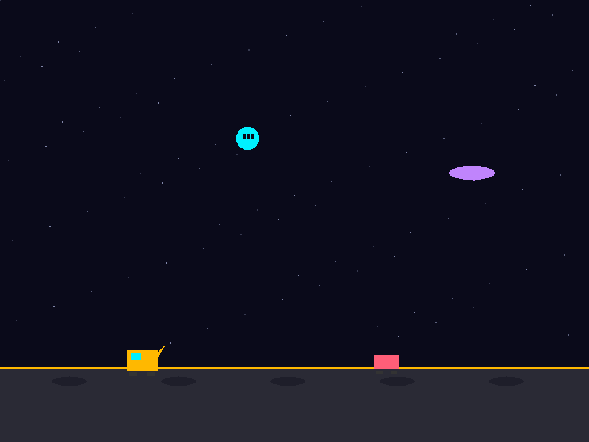

# 🌙 Moon Patrol

**Versión:** 1.1.0 | **Género:** Shooter | **Última actualización:** 2026-08-28

Side-scroll lunar shooter clásico. Patrullá la luna esquivando cráteres y destruyendo enemigos con disparos hacia adelante y hacia arriba.

## Captura

## Controles

| Dispositivo | Acción              | Tecla / Control      |
| ----------- | ------------------- | -------------------- |
| ⌨️ Teclado  | Saltar              | `↑` / `W`            |
| ⌨️ Teclado  | Disparar adelante   | `→` / `D` (mantener) |
| ⌨️ Teclado  | Disparar arriba     | `↑` / `W` (mantener) |
| ⌨️ Teclado  | Pausar              | `Espacio` / `P`      |
| ⌨️ Teclado  | Reiniciar           | `R`                  |
| 🎮 Gamepad  | Saltar              | D-pad arriba / A     |
| 🎮 Gamepad  | Disparar            | D-pad derecha / B    |
| 🎮 Gamepad  | Empezar / Pausar    | Start                |
| 👆 Táctil   | Botones en pantalla |                      |

## Características

- 🌙 Side-scroll con parallax de estrellas
- 🚗 Buggy lunar con saltos y 2 direcciones de disparo
- 👾 3 tipos de enemigos: rovers (ground), UFOs (air + shooting), mines/cráteres (obstacle)
- ⚡ Power-ups: **triple shot** (3 direcciones) y **rapid fire**
- 🏁 Niveles por distancia alcanzada con bonus de tiempo
- 💥 Game feel: screen shake, partículas neon, engine sound
- 📊 Puntaje y récord persistido en `localStorage`
- ♿ Accesibilidad: anuncios `aria-live`, prefers-reduced-motion
- 🎮 Soporte para teclado, táctil y gamepad

## Logros

- 🏆 **Triple kill** — Matá 3 enemigos con un solo triple shot
- 🏆 **Sin saltos** — Completá un nivel sin saltar
- 🏆 **Speed run** — Completá un nivel en menos de 45 segundos

## Detalles técnicos

- Canvas 2D sin dependencias externas
- Game loop con `shared/loop.js`
- Canvas responsive con `shared/display.js`
- Shell compartido vía `shared/shell.js`
- Audio sintetizado con `shared/audio.js`
- Game feel: screen shake, partículas, `feedbackBundle`
- Persistencia en `localStorage` (`moonPatrol`)
- 3 modos de entrada: teclado, táctil, gamepad

## Changelog

- **1.0.0** (2026-08-28): Initial release
- **1.1.0** (2026-08-28): Fix de colisiones y cráteres, niveles por distancia, power-ups triple/rapid, logros de spec, tema musical
