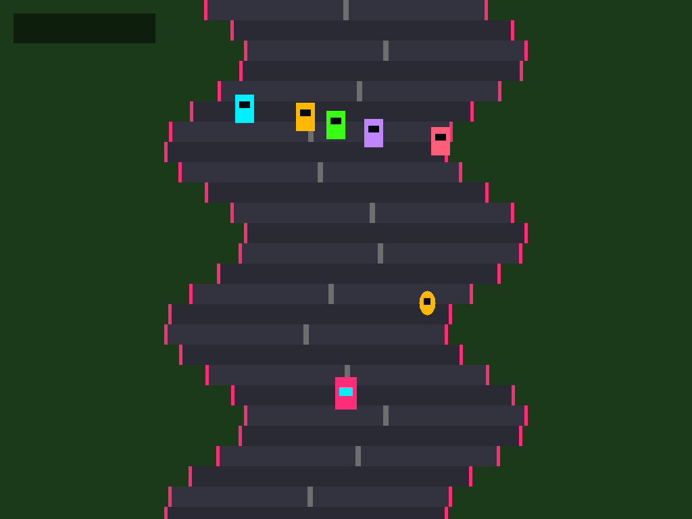

# 🏎️ Pole Position

**Versión:** 1.0.0 | **Género:** Racing | **Última actualización:** 2026-08-28

Racing top-down clásico. Calificá en menos de 35 segundos para empezar en pole position, luego ganá la carrera de 3 vueltas esquivando 8 rivales y usando el turbo.

## Captura

## Controles

| Dispositivo | Acción | Tecla / Control |
| ----------- | ------ | --------------- |
| ⌨️ Teclado | Acelerar | `↑` / `W` |
| ⌨️ Teclado | Frenar | `↓` / `S` |
| ⌨️ Teclado | Girar izquierda | `←` / `A` |
| ⌨️ Teclado | Girar derecha | `→` / `D` |
| ⌨️ Teclado | Turbo | `Espacio` |
| ⌨️ Teclado | Pausar | `P` |
| ⌨️ Teclado | Reiniciar | `R` |
| 🎮 Gamepad | Acelerar / Frenar | D-pad / Stick |
| 🎮 Gamepad | Turbo | Botón A |
| 🎮 Gamepad | Empezar / Pausar | Start |
| 👆 Táctil | Botones en pantalla | |

## Características

- 🏁 Modo calificación (35s) + carrera (3 vueltas, 60s)
- 🚗 8 rivales con IA de lane-keeping
- ⚡ Turbo con cooldown (2s boost, 5s recarga)
- 🛣️ Curvas de road que afectan el steering
- 💥 Colisiones con slowdown
- 💥 Game feel: screen shake al chocar, engine sound
- 📊 Posición y tiempo persistido
- ♿ Accesibilidad: anuncios `aria-live`, prefers-reduced-motion
- 🎮 Soporte para teclado, táctil y gamepad

## Logros

- 🏆 **Primera carrera** — Completá tu primera carrera
- 🏆 **Podium** — Terminá en los 3 primeros
- 🏆 **Campeón** — Ganá la carrera

## Detalles técnicos

- Canvas 2D sin dependencias externas
- Road rendering con curvas por segmento
- Game loop con `shared/loop.js`
- Canvas responsive con `shared/display.js`
- Shell compartido vía `shared/shell.js`
- Audio sintetizado con `shared/audio.js`
- Game feel: screen shake, partículas, `feedbackBundle`
- Persistencia en `localStorage` (`polePosition`)
- 3 modos de entrada: teclado, táctil, gamepad

## Changelog

- **1.0.0** (2026-08-28): Initial release
