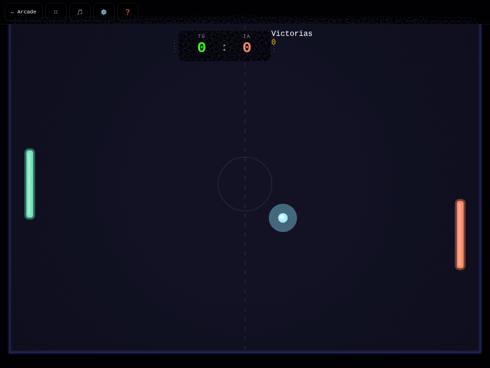

# 🏓 Pong

**Versión:** 1.7.0 | **Género:** Deportes | **Última actualización:** 2026-08-26

El clásico de tenis de mesa recreado en canvas 2D. Primero en llegar a 7 puntos gana.

## Captura

## Controles

| Dispositivo | Acción                                     | Tecla / Control         |
| ----------- | ------------------------------------------ | ----------------------- |
| ⌨️ Teclado  | P1: mover arriba                           | `W` (o `↑` en 1P)       |
| ⌨️ Teclado  | P1: mover abajo                            | `S` (o `↓` en 1P)       |
| ⌨️ Teclado  | P2 (modo 2P): mover arriba                 | `↑`                     |
| ⌨️ Teclado  | P2 (modo 2P): mover abajo                  | `↓`                     |
| ⌨️ Teclado  | Cambiar modo 1P (IA) / 2P local            | `Tab`                   |
| ⌨️ Teclado  | Empezar / Sacar                            | `Espacio`               |
| ⌨️ Teclado  | Reiniciar                                  | `R`                     |
| 🎮 Gamepad  | Movimiento                                 | Stick izquierdo / D-pad |
| 🎮 Gamepad  | Empezar / Sacar                            | Botón A / Start         |
| 👆 Táctil   | Botones ▲ ▼ en pantalla (visible en móvil) |                         |

## Características

- 🧠 IA de la paleta rival humanizada: delay de reacción variable y error de puntería (modo 1P)
- 🎮 Modo 2P local (PvP): `W`/`S` vs `↑`/`↓` en el mismo teclado — alterná con `Tab`
- 💥 Game feel: screen shake, hit-stop, squash & stretch, partículas neon al golpear la pelota y al anotar
- 📊 Contador de victorias persistido en `localStorage`
- ♿ Accesibilidad: anuncios `aria-live`, focus trapping, prefers-reduced-motion
- 🌓 Soporte de tema claro/oscuro
- 🎮 Soporte para teclado, táctil y gamepad

## Logros

- 🏆 **Primera victoria** — Ganá tu primera partida
- 🏆 **Racha ganadora** — Ganá 5 partidas

## Consejos

- Tratá de mantener la pelota en el centro de la paleta para tener más control de la dirección
- La velocidad de la pelota aumenta con cada golpe

## Detalles técnicos

- Canvas 2D sin dependencias externas
- Game loop con `shared/loop.js` (`createGameLoop` con RAF + dt + cleanup)
- Canvas responsive con `shared/display.js` (`setupCanvas` con DPR + letterboxing + resize debounce)
- HTML compartido inyectado vía `shared/dom.js` (`injectCommonElements`)
- Shell compartido vía `shared/shell.js` (`setupGameShell`: game-bar, trampa de Tab y cleanup unificados)
- Estilos neon desde `shared/base.css` (overlay, HUD, touch controls, game bar, noise CRT)
- Audio sintetizado con `shared/audio.js` (Web Audio API: beep, ambient drone)
- Game feel: screen shake por trauma, hit-stop, squash & stretch, partículas con object pool (500), `feedbackBundle` por tiers
- Rendimiento: glow sin `shadowBlur` (`drawGlow`), anti-tunneling en sub-pasos, object pooling
- Accesibilidad: `aria-live` announcements, `trapTab()` focus trapping, prefers-reduced-motion → `setShakeScale(0)`, modal de ayuda accesible (role=dialog + focus trap), canvas con `role="img"`, zoom móvil habilitado, `:focus-visible` global
- Persistencia en `localStorage` con key namespaced (`pong2d_wins`)
- 3 modos de entrada: teclado (W/S + ↑/↓ en 2P, Espacio, R, Tab), táctil (botones responsive), gamepad (polling en loop)

## Changelog

- **1.7.0** (2026-08-27): P2 touch controls + keyboard fix + stopMusic/stopAmbient
- **1.6.0** (2026-08-26): Refactor: shell compartido shared/shell.js — game-bar, trampa de Tab y cleanup unificados
- **1.5.1** (2026-08-24): Música lofi procedural «Midnight Rally» vía `shared/music.js` + toggle 🎵 en game-bar (preferencia global persistida)
- **1.5.0** (2026-07-30): Game feel completo — `feedbackBundle()` integrado + squash & stretch + hit-stop; P0: `shadowBlur` eliminado de loops con `drawGlow()`; lint 0 errores/0 warnings
- **1.4.0** (2026-07-30): Migración a `shared/loop.js`; `shimmerFlow` a `base.css`; `drawGlow()` y `feedbackBundle()`; vestigios 3D renombrados (`ball.z → .y`)
- **1.3.0** (2026-07-30): Canvas ID unificado + `setupCanvas()` vía `shared/display.js`; HTML compartido vía `shared/dom.js`
- **1.2.0** (2026-07-28): Refactor CSS a estética neon compartida en `base.css`; README con controles y descripción
- **1.1.0** (2026-07-28): Refactor a carpeta individual; botón ayuda + volver al hub; soporte `shared/effects.js`; screen shake y partículas
- **1.0.0** (2026-06-01): Versión inicial del juego