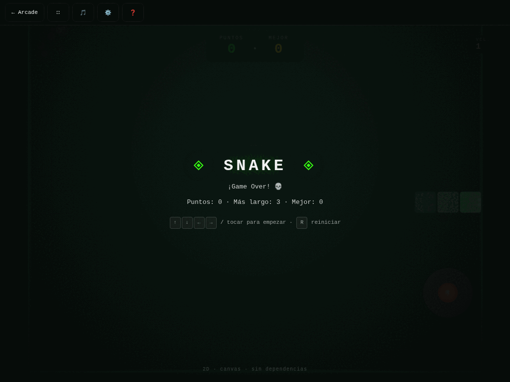

# 🐍 Snake

**Versión:** 1.7.0 | **Género:** Arcade | **Última actualización:** 2026-08-26

El clásico de la serpiente. Atrapá la comida para crecer y sumar puntos sin chocarte contra las paredes ni contra vos mismo.

## Captura

## Controles

| Dispositivo | Acción                        | Tecla / Control         |
| ----------- | ----------------------------- | ----------------------- |
| ⌨️ Teclado  | Mover arriba                  | `↑` / `W`               |
| ⌨️ Teclado  | Mover abajo                   | `↓` / `S`               |
| ⌨️ Teclado  | Mover izquierda               | `←` / `A`               |
| ⌨️ Teclado  | Mover derecha                 | `→` / `D`               |
| ⌨️ Teclado  | Pausar / Reanudar             | `Espacio` / `P`         |
| ⌨️ Teclado  | Reiniciar                     | `R`                     |
| 🎮 Gamepad  | Movimiento                    | D-pad / Stick izquierdo |
| 🎮 Gamepad  | Empezar / Pausar              | Start / Select          |
| 👆 Táctil   | D-pad direccional en pantalla |                         |

## Características

- 🐍 Velocidad progresiva a medida que crecés
- 💥 Game feel: screen shake, hit-stop, partículas neon al comer y al morir
- 📊 Puntaje y récord persistido en `localStorage` vía `shared/scores.js`
- ♿ Accesibilidad: anuncios `aria-live`, prefers-reduced-motion
- 🎮 Soporte para teclado, táctil y gamepad

## Logros

- 🏆 **Decatlón** — Alcanzá 10 puntos de récord
- 🏆 **Creciente** — Alcanzá 25 puntos
- 🏆 **Demonio de velocidad** — Alcanzá velocidad máxima
## Detalles técnicos

- Canvas 2D sin dependencias externas
- Game loop con `shared/loop.js` (`createGameLoop` con RAF + dt + cleanup)
- Canvas responsive con `shared/display.js` (`setupCanvas` con DPR + letterboxing + resize debounce)
- HTML compartido inyectado vía `shared/dom.js` (`injectCommonElements`)
- Shell compartido vía `shared/shell.js` (`setupGameShell`: game-bar, trampa de Tab y cleanup unificados)
- Estilos neon desde `shared/base.css` (overlay, HUD, touch controls, game bar, noise CRT)
- Audio sintetizado con `shared/audio.js` (Web Audio API: beep, ambient drone)
- Game feel: screen shake por trauma, hit-stop, squash & stretch, partículas con object pool (500), `feedbackBundle` por tiers
- Rendimiento: glow sin `shadowBlur` (`drawGlow`), object pooling
- Accesibilidad: `aria-live` announcements, `trapTab()` focus trapping, prefers-reduced-motion → `setShakeScale(0)`, modal de ayuda accesible (role=dialog + focus trap), canvas con `role="img"`, zoom móvil habilitado, `:focus-visible` global
- Persistencia en `localStorage` con key namespaced (`snake2d` vía `shared/scores.js`)
- 3 modos de entrada: teclado (flechas/WASD + Espacio/P + R), táctil (d-pad responsive), gamepad (polling en loop)

## Changelog

- **1.7.0** (2026-08-27): stopMusic/stopAmbient + ambient drone único + achievements
- **1.6.0** (2026-08-26): Refactor: shell compartido shared/shell.js — game-bar, trampa de Tab y cleanup unificados | Refactor: récords vía shared/scores.js | Fix: teardown de audio garantizado en cleanup
- **1.5.2** (2026-08-26): Música lofi procedural vía `shared/music.js` + toggle 🎵 en game-bar (preferencia global persistida)
- **1.5.1** (2026-07-31): R1: coordenadas de grid `.z/.dz` renombradas a `.y/.dy` — último vestigio 3D eliminado
- **1.5.0** (2026-07-30): Game feel completo — `feedbackBundle()` integrado + squash & stretch + hit-stop; P0: `shadowBlur` eliminado de loops con `drawGlow()`; lint 0 errores/0 warnings
- **1.4.0** (2026-07-30): Migración a `shared/loop.js`; `shimmerFlow` a `base.css`; `drawGlow()` y `feedbackBundle()`
- **1.3.0** (2026-07-30): Canvas ID unificado + `setupCanvas()` vía `shared/display.js`; HTML compartido vía `shared/dom.js`
- **1.2.0** (2026-07-28): Refactor CSS a estética neon compartida en `base.css`; README con controles y descripción
- **1.1.0** (2026-07-28): Refactor a carpeta individual; botón ayuda + volver al hub; screen shake y partículas
- **1.0.0** (2026-06-05): Versión inicial del juego