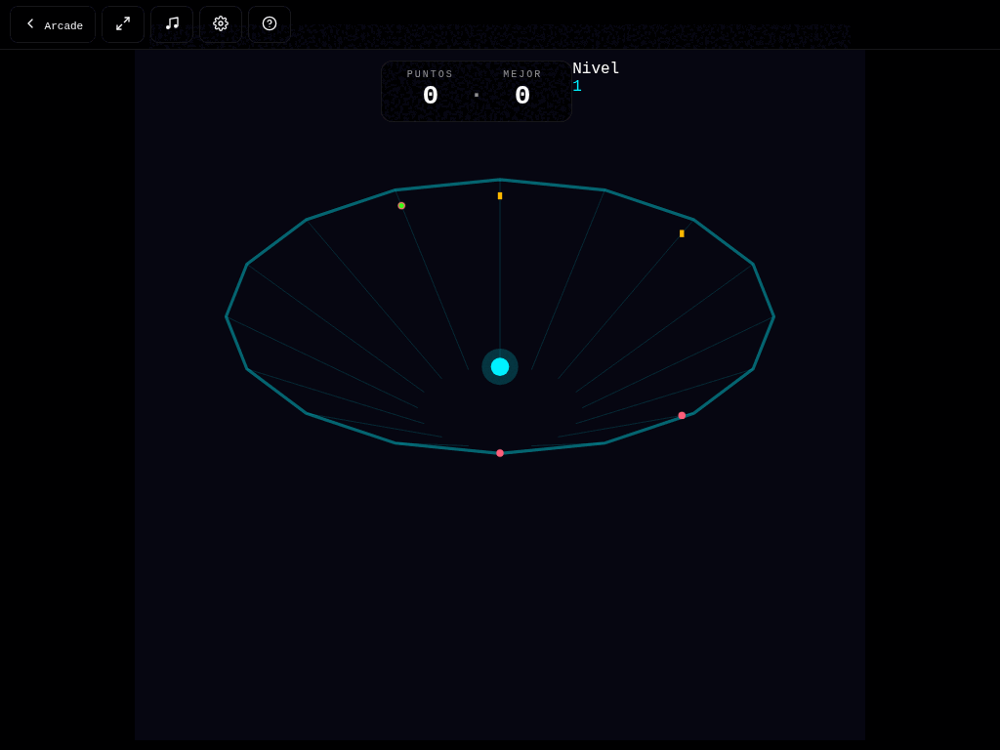

# 🌀 Tempest

**Versión:** 1.0.0 | **Género:** Shooter | **Última actualización:** 2026-08-28

Tube shooter clásico. Dispará a los enemigos que suben por el tubo de 16 lados mientras rotás alrededor del borde.

## Captura

## Controles

| Dispositivo | Acción | Tecla / Control |
| ----------- | ------ | --------------- |
| ⌨️ Teclado | Rotar izquierda | `←` / `A` |
| ⌨️ Teclado | Rotar derecha | `→` / `D` |
| ⌨️ Teclado | Disparar | `Espacio` |
| ⌨️ Teclado | Jump (esquivar) | `↑` / `W` |
| ⌨️ Teclado | Pausar | `P` |
| ⌨️ Teclado | Reiniciar | `R` |
| 🎮 Gamepad | Rotar | D-pad izq/der |
| 🎮 Gamepad | Disparar | Botón A |
| 🎮 Gamepad | Jump | Botón B |
| 🎮 Gamepad | Empezar / Pausar | Start |
| 👆 Táctil | Botones en pantalla | |

## Características

- 🌀 Tubo de 16 lados con perspectiva 3D simulada
- 👾 3 tipos de enemigos: fuseballs (invulnerables), spikers, pulsars
- 🦘 Jump: saltar al otro lado del tubo para esquivar
- ⚡ Oleadas progresivas con dificultad creciente
- 💥 Game feel: screen shake, partículas neon, glow effects
- 📊 Puntaje y récord persistido en `localStorage`
- ♿ Accesibilidad: anuncios `aria-live`, prefers-reduced-motion
- 🎮 Soporte para teclado, táctil y gamepad

## Logros

- 🏆 **Primera partida** — Jugá tu primera partida
- 🏆 **Alto puntaje** — Alcanzá 1000 puntos
- 🏆 **Sobreviviente** — Alcanzá oleada 5

## Detalles técnicos

- Canvas 2D sin dependencias externas
- Tube rendering con 16 lados y perspectiva
- Game loop con `shared/loop.js`
- Canvas responsive con `shared/display.js`
- Shell compartido vía `shared/shell.js`
- Audio sintetizado con `shared/audio.js`
- Game feel: screen shake, partículas, `feedbackBundle`
- Persistencia en `localStorage` (`tempest2d`)
- 3 modos de entrada: teclado, táctil, gamepad

## Changelog

- **1.0.0** (2026-08-28): Initial release
