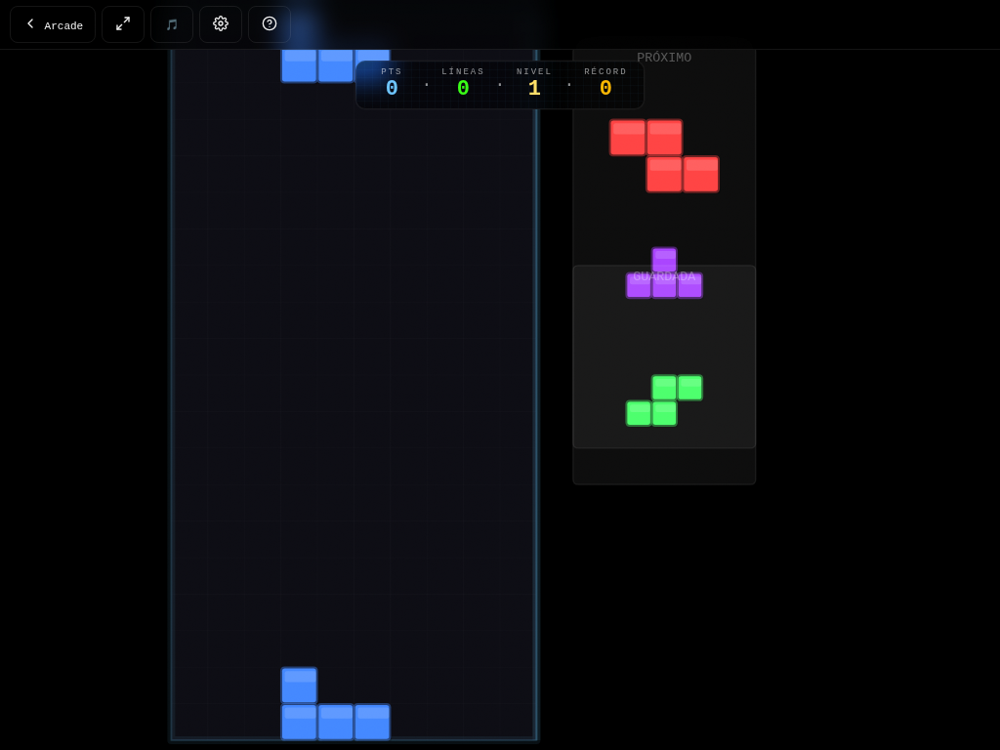

# 🧊 Tetris

**Versión:** 2.0.0 | **Género:** Puzzle | **Última actualización:** 2026-08-26

Armá líneas con las 7 piezas que caen. Rotación, ghost piece, niveles progresivos. ¡Clásico infinito!

## Captura

## Controles

| Dispositivo | Acción                                         | Tecla / Control     |
| ----------- | ---------------------------------------------- | ------------------- |
| ⌨️ Teclado  | Mover izquierda                                | `←` / `A`           |
| ⌨️ Teclado  | Mover derecha                                  | `→` / `D`           |
| ⌨️ Teclado  | Rotar horario                                  | `↑` / `W`           |
| ⌨️ Teclado  | Rotar antihorario                              | `Z`                 |
| ⌨️ Teclado  | Caída rápida                                   | `↓` / `S`           |
| ⌨️ Teclado  | Soltar (hard drop)                             | `Espacio`           |
| ⌨️ Teclado  | Guardar pieza (hold)                           | `C` / `Shift`       |
| ⌨️ Teclado  | Pausa                                          | `P`                 |
| 🎮 Gamepad  | Mover / Rotar                                  | D-pad + botones A/B |
| 🎮 Gamepad  | Guardar pieza (hold)                           | LB                  |
| 👆 Táctil   | Botones en pantalla (← → rotar ⬇ soltar, hold) |                     |

## Características

- 🟦 7 piezas clásicas (I, O, T, S, Z, J, L)
- 🔄 Rotación SRS oficial: wall kicks por pieza (tablas I y JLSTZ), giro horario (`↑`/`W`) y antihorario (`Z`)
- ⇄ Hold piece: guardá la pieza actual (`C`/`Shift`, `LB` del gamepad o botón táctil) con un uso por pieza
- 🧊 T-Spin: detección full (3+ esquinas) y mini (2 esquinas frontales) con scoring dedicado (Single 400, Double 800, Triple 1200, Mini Single 100) + anuncios al aterrizar
- 📈 Bonus back-to-back ×1,5 en Tetrises/T-Spins consecutivos sin line clear normal + indicador `B2B` en el HUD
- 🛢️ 7-bag randomizer (Fisher-Yates): las 7 piezas se reparten por ronda antes de repetir
- ⏱️ Lock delay 0,5 s wall-clock (máx. 15 resets) + soft drop con scoring (1 punto por celda bajada)
- 👻 Ghost piece que muestra dónde caerá la pieza
- ⚡ Niveles progresivos que aumentan la velocidad
- 💥 Game feel: screen shake, hit-stop, partículas neon al completar líneas
- 🏆 Récord persistido en `localStorage` vía `shared/scores.js`
- ♿ Accesibilidad: anuncios `aria-live`, prefers-reduced-motion
- 🎮 Soporte para teclado, táctil y gamepad

## Logros

- 🏆 **Constructor de líneas** — Alcanzá 500 puntos de récord
- 🏆 **Tetris** — Completá 4 líneas de una vez
- 🏆 **Siglo** — Completá 100 líneas en total

## Detalles técnicos

- Canvas 2D sin dependencias externas
- Game loop con `shared/loop.js` (`createGameLoop` con RAF + dt + cleanup)
- Canvas responsive con `shared/display.js` (`setupCanvas` con DPR + letterboxing + resize debounce)
- HTML compartido inyectado vía `shared/dom.js` (`injectCommonElements`)
- Shell compartido vía `shared/shell.js` (`setupGameShell`: game-bar, trampa de Tab y cleanup unificados)
- Estilos neon desde `shared/base.css` (overlay, HUD, touch controls, game bar, noise CRT)
- Audio sintetizado con `shared/audio.js` (Web Audio API: beep, ambient drone)
- Game feel: screen shake por trauma, hit-stop, squash & stretch, partículas con object pool (500), `feedbackBundle` por tiers
- Rendimiento: glow sin `shadowBlur` (`drawGlow`), object pooling
- Accesibilidad: `aria-live` announcements, `trapTab()` focus trapping, prefers-reduced-motion → `setShakeScale(0)`, modal de ayuda accesible (role=dialog + focus trap), canvas con `role="img"`, zoom móvil habilitado, `:focus-visible` global
- Persistencia en `localStorage` con key namespaced (`tetris2d` vía `shared/scores.js`)
- 3 modos de entrada: teclado (flechas/WASD + Espacio + C/Shift + Z + P), táctil (botones responsive), gamepad (polling en loop)
- Mecánicas Guideline: SRS con tablas de wall kicks, 7-bag randomizer, lock delay 0,5 s, DAS, T-Spin y B2B

## Changelog

- **2.0.0** (2026-08-27): Fix render loop (bottom rows visible) + stopMusic/stopAmbient + achievements
- **1.9.0** (2026-08-26): T-Spin detection: full T-Spin (3+ corners) y mini T-Spin (2 front corners) | Back-to-back bonus: ×1.5 score en Tetrises/T-Spins consecutivos sin line clear normal | T-Spin scoring: Single 400, Double 800, Triple 1200, Mini Single 100 | B2B indicator en HUD + T-Spin/Tetris announcements
- **1.8.0** (2026-08-26): Paridad arcade: soft drop scoring (1 punto por celda bajada)
- **1.7.0** (2026-08-26): Paridad arcade: 7-bag randomizer (Fisher-Yates) + lock delay 0.5s wall-clock con max 15 resets
- **1.6.0** (2026-08-26): Hold piece: guardá/cambiá la pieza actual (C / Shift / LB / botón táctil) | Rotación SRS oficial con tablas de wall kicks por pieza (I y JLSTZ) + rotación antihoraria (Z)
- **1.5.1** (2026-08-24): Música lofi-chiptune «Neon Blocks» vía `shared/music.js` + toggle 🎵 en game-bar (preferencia global persistida)
- **1.5.0** (2026-07-30): Game feel completo — `feedbackBundle()` integrado + squash & stretch + hit-stop; P0: `shadowBlur` eliminado de loops con `drawGlow()`; lint 0 errores/0 warnings; fix refs rotas BOARD_W/H→CW/CH
- **1.4.0** (2026-07-30): Migración a `shared/loop.js`; `shimmerFlow` a `base.css`; `drawGlow()` y `feedbackBundle()`; constantes extraídas (BASE_DROP_SPEED, SPEED_PER_LEVEL)
- **1.3.0** (2026-07-30): Canvas ID unificado + `setupCanvas()` vía `shared/display.js`; HUD IDs legibles; HTML compartido vía `shared/dom.js`
- **1.2.0** (2026-07-28): Refactor CSS a estética neon compartida en `base.css`; README con controles y descripción
- **1.1.0** (2026-07-28): Refactor a carpeta individual; botón ayuda + volver al hub; screen shake y partículas
- **1.0.0** (2026-06-20): Versión inicial del juego
